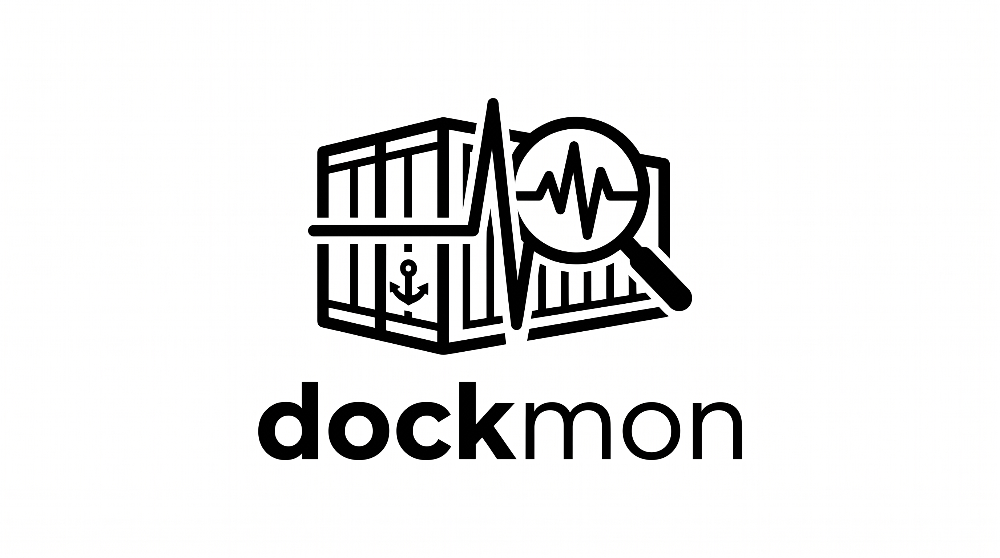

# DockMon

<p align="center">
  
</p>

[](https://dockmon.zephyrus-labs.tech/)
[](https://github.com/uchiha-fire/vps-monitoring-tool/releases)
[](https://github.com/uchiha-fire/vps-monitoring-tool)
[](https://github.com/uchiha-fire/vps-monitoring-tool)
[](https://github.com/uchiha-fire/vps-monitoring-tool)
[](LICENSE)
[](https://www.linkedin.com/in/shubham-sharma-28487819b/)
[](https://zephyrus-labs.tech/)

**DockMon** is a lightweight, agentless desktop application by **[Zephyrus Labs](https://zephyrus-labs.tech/)** to monitor, inspect, and manage **Docker** containers and **Docker Compose** stacks across remote Linux VPS instances over pure SSH.

🌐 **Product Website & Downloads**: [https://dockmon.zephyrus-labs.tech/](https://dockmon.zephyrus-labs.tech/)

Stream real-time ANSI-colored logs, manage service lifecycles, and organize compose stacks without exposing the Docker daemon socket over public TCP ports.

---

## 🌟 Key Features

- **🚀 Paste-and-Connect SSH Parser**: Connect by pasting raw terminal commands like `ssh -p 2222 user@123.45.67.89` or `ssh -i ~/.ssh/key.pem user@host`. Automatic parsing of port, identity keys, flags, and usernames in real time.
- **📦 Docker Compose Stack Grouping**: Automatically identifies Compose stacks (`com.docker.compose.project`) and categorizes services into hierarchical stacks vs. standalone containers.
- **🖥️ High-Speed ANSI Terminal Streaming**: Powered by **`xterm.js`**, stream live container logs (`docker logs -f --tail N`) with full ANSI 256/TrueColor support, pause/unpause scroll lock, and instant regex search.
- **⚡ Container Lifecycle Controls**: Start, Stop, and Restart individual containers or entire Docker Compose project stacks with built-in safety confirmation dialogs.
- **🏷️ Health & Port Telemetry**: Real-time status indicators (Running 🟢, Exited 🔴, Restarting 🟡, Paused ⏸️) with Docker health check detection (`healthy`, `unhealthy`, `starting`) and host-to-container port mapping chips.
- **🔖 Connection Bookmarks**: Save frequently accessed VPS servers as encrypted bookmarks in `~/.dockmon/` for instant one-click switching.
- **🛡️ 100% Agentless & Secure**: Zero agent software required on the VPS. Communicates directly over encrypted SSH channels via pure JavaScript `ssh2`.
- **🧪 Rigorous TDD Architecture**: Backed by 53 unit and integration test suites running offline against an in-memory mock SSH server.

---

## 📸 Overview & Architecture

```
┌────────────────────────────────────────────────────────┐
│                    DockMon (Desktop)                   │
│                                                        │
│  ┌──────────────────────┐    IPC    ┌────────────────┐ │
│  │   Renderer Process   │ ◄───────► │  Main Process  │ │
│  │  - React 18 + Vite   │           │  (Node.js ESM) │ │
│  │  - Tailwind CSS UI   │           │  - ssh2 Client │ │
│  │  - xterm.js Terminal │           │  - Log RingBuf │ │
│  └──────────────────────┘           └────────┬───────┘ │
└──────────────────────────────────────────────┼─────────┘
                                               │ Encrypted SSH
                                               ▼
                                    ┌─────────────────────┐
                                    │   Remote Linux VPS  │
                                    │ - docker ps -a      │
                                    │ - docker compose ls │
                                    │ - docker logs -f    │
                                    └─────────────────────┘
```

---

## 📥 Download & Multi-Platform Installation

DockMon is available across Linux, Windows, and macOS.

### 🐧 Linux (100% Free, Native Support)
Works on all major distributions with zero external dependencies:
- **Universal AppImage**: Download `dockmon-1.0.0.AppImage`, run `chmod +x`, and double-click to launch on Ubuntu, Fedora, Debian, Arch, openSUSE, etc.
  ```bash
  chmod +x dockmon-1.0.0.AppImage
  ./dockmon-1.0.0.AppImage
  ```
- **Debian / Ubuntu (`.deb`)**:
  ```bash
  cd ~/Downloads
  sudo apt install ./dockmon-1.0.0.deb
  # Or: sudo apt install ~/Downloads/dockmon-1.0.0.deb
  ```
- **Fedora / RHEL (`.rpm`)**:
  ```bash
  sudo dnf install ./dockmon-1.0.0.x86_64.rpm
  ```

### 🪟 Windows (100% Free)
- **Installer (`.exe`)**: Download and run `DockMon-Setup-1.0.0.exe`.
- **Portable (`.exe`)**: Standalone binary `DockMon-1.0.0-portable.exe` with zero setup required.
- **Windows Package Manager (`winget`)**:
  ```powershell
  winget install dockmon
  ```

### 🍎 macOS
- **Apple Silicon (`arm64`)**: Native build optimized for M1, M2, M3, and M4 chips.
- **Intel (`x64`)**: Standard 64-bit build for Intel Macs.
- **Universal (`.dmg`)**: Single package that executes on both architectures.

---

## 🚀 Quick Start Guide

### 1. Launch the Application
```bash
# Clone the repository
git clone https://github.com/uchiha-fire/vps-monitoring-tool.git
cd vps-monitoring-tool

# Install dependencies
npm install

# Start the desktop application in development mode
npm run dev
```

### 2. Connect to Your Remote VPS
1. Click **"Connect to VPS"** in the top navigation bar.
2. Paste your standard SSH command:
   ```bash
   ssh -p 2222 ubuntu@your-server-ip
   ```
3. Enter your password or select your private key (`~/.ssh/id_rsa`).
4. (Optional) Check **"Save this VPS connection as a bookmark"** to label and store the host for one-click reconnection.
5. Click **Connect**.

### 3. Inspect & Control Services
- **View Stacks**: Docker Compose projects are grouped together with stack-level counters and batch controls.
- **Stream Logs**: Click the **Logs** button next to any container to stream live stdout/stderr logs.
- **Search & Pause**: In the log viewer, use the search input to highlight occurrences, toggle auto-scroll follow, or change tail presets (`50`, `100`, `250`, `500`, `1000`).

---

## 🛠️ Development & TDD Workflow

This project strictly adheres to **Test-Driven Development (TDD)** using **Vitest** and **React Testing Library**. All remote commands and SSH channels are validated offline against an in-memory mock SSH server.

### Running Test Suites
```bash
# Run all 51 unit & integration test suites
npm test

# Run tests in continuous watch mode
npm run test:watch

# Generate code coverage reports
npm run test:coverage
```

### Building for Production
```bash
# Compile TypeScript, Vite frontend, and Electron processes
npm run build
```

---

## 🧰 Technology Stack

| Layer | Component | Description |
| :--- | :--- | :--- |
| **Desktop Shell** | [Electron 33+](https://www.electronjs.org/) | Cross-platform desktop framework with secure IPC context isolation |
| **User Interface** | [React 18](https://react.dev/) + [TypeScript](https://www.typescriptlang.org/) | Type-safe, reactive component hierarchy |
| **Bundler & Tooling** | [Vite](https://vitejs.dev/) + `vite-plugin-electron` | Fast HMR dev server and lean production compilation |
| **SSH Subsystem** | [`ssh2`](https://github.com/mscdex/ssh2) | Pure JavaScript SSH2 client for Node.js |
| **Log Terminal** | [`@xterm/xterm`](https://xtermjs.org/) | High-performance canvas/WebGL terminal with search & fit addons |
| **Styling & Theme** | [Tailwind CSS](https://tailwindcss.com/) | Dark-mode developer aesthetics with custom scrollbars and animations |
| **Iconography** | [Lucide React](https://lucide.dev/) | Clean, modern developer and DevOps icons |
| **Testing** | [Vitest](https://vitest.dev/) + Testing Library | ESM-native testing harness with mock SSH integration |

---

## 🏢 Developed & Maintained by Zephyrus Labs

Built and maintained with ❤️ by **[Zephyrus Labs](https://zephyrus-labs.tech/)**.

- 👨‍💻 **Lead Developer**: **Shubham Sharma**
- 🔗 **LinkedIn**: [shubham-sharma-28487819b](https://www.linkedin.com/in/shubham-sharma-28487819b/)
- 💻 **GitHub**: [@uchiha-fire](https://github.com/uchiha-fire)
- 🌐 **Website**: [zephyrus-labs.tech](https://zephyrus-labs.tech/) &bull; [dockmon.zephyrus-labs.tech](https://dockmon.zephyrus-labs.tech/)
- ✉️ **Contact**: [sharmashubham25962@gmail.com](mailto:sharmashubham25962@gmail.com) &bull; [zephyrus.labs@gmail.com](mailto:zephyrus.labs@gmail.com)

If you find this application helpful in managing your remote infrastructure, please consider giving it a ⭐️ on [GitHub](https://github.com/uchiha-fire/vps-monitoring-tool)!

---

## 🤝 Acknowledgements & Attributions

This project is made possible through the outstanding open-source contributions of:

- **[Electron](https://github.com/electron/electron)**: Cross-platform desktop application framework. Licensed under MIT.
- **[ssh2](https://github.com/mscdex/ssh2)**: Pure JavaScript SSH2 client for Node.js. Licensed under MIT.
- **[xterm.js](https://github.com/xtermjs/xterm.js)**: Terminal front-end component for the web. Licensed under MIT.
- **[React](https://github.com/facebook/react)**: Declarative, component-based UI library. Licensed under MIT.
- **[Vite](https://github.com/vitejs/vite)**: Next generation frontend tooling. Licensed under MIT.
- **[Vitest](https://github.com/vitest-dev/vitest)**: Blazing fast unit test framework. Licensed under MIT.
- **[Tailwind CSS](https://github.com/tailwindlabs/tailwindcss)**: Utility-first CSS framework. Licensed under MIT.
- **[Lucide Icons](https://github.com/lucide-icons/lucide)**: Beautiful & consistent icon toolkit. Licensed under ISC.

---

## 📄 License

This project is licensed under the **MIT License** - see the [LICENSE](LICENSE) file for complete details.

---

<p align="right">
  <sub>Lead Developer: <a href="https://www.linkedin.com/in/shubham-sharma-28487819b/">Shubham Sharma</a> (<a href="https://github.com/uchiha-fire">@uchiha-fire</a>) &bull; <a href="mailto:sharmashubham25962@gmail.com">sharmashubham25962@gmail.com</a></sub>
</p>
